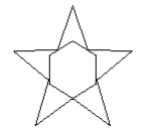

# Computer Graphics — Лабораторные работы

Набор лабораторных работ по компьютерной графике на Python (Matplotlib/Tkinter): аналитическая геометрия, геометрические преобразования, растеризация, отсечение, заполнение областей и выпуклые оболочки.

## Содержание

| # | Тема | Что реализовано |
|---|------|-----------------|
| [1](lab1) | Аналитическая геометрия | Принадлежность точки прямой / лучу / плоскости, ориентация обхода треугольника, пересечение окружности с касательными ([1.py](lab1/1.py)–[5.py](lab1/5.py)) |
| [2](lab2) | Геометрические преобразования | Перенос, отражения (OX, OY, Y=X), масштабирование, поворот вокруг центра и произвольной точки; восстановление исходной позиции. Часть 2 — имитация падения снежинок ([2_1–2_3](lab2)) |
| [3](lab3) | Растеризация | Алгоритмы Брезенхема для отрезка и окружности (только целочисленные вычисления) |
| [4](lab4) | Отсечение отрезков | Алгоритмы Цируса–Бека, Сазерленда–Коэна и средней точки; визуализация точек входа/выхода |
| [5](lab5) | Заполнение областей | Алгоритм XOR-2 с перегородкой, пошаговая демонстрация |
| [6](lab6) | Выпуклая оболочка | Алгоритм Джарвиса с пошаговым построением |



## Запуск

Каждая лаборатория — самостоятельный скрипт:

```bash
python lab2/app.py
```

Зависимости: `matplotlib`, `numpy` (или стандартная библиотека — зависит от работы).

## Скриншоты

> TODO: добавить скриншоты по каждой работе (растеризация Брезенхема, отсечение Цируса–Бека, XOR-заливка, пошаговое построение оболочки Джарвиса).

## License

MIT
